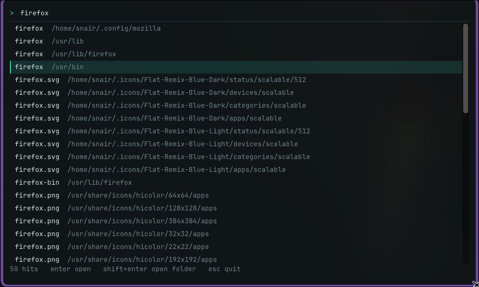

# Fizz - System Wide Fuzzy Search!
* A super quick system wide fuzzy search app.
* Specialises in finding files

## Demo Screenshot


## V1
* I cannot speak to this thing's reliability but it seems to work on my PC™ for now (Arch btw).

## Prerequisites
Fizz needs a C++17 compiler, CMake, and GLFW + OpenGL development headers.
(Dear ImGui is bundled in `imgui/`, so there's nothing to install for it.)

| Distro | Command |
| --- | --- |
| Arch | `sudo pacman -S --needed base-devel cmake glfw-x11` |
| Fedora | `sudo dnf install gcc-c++ make cmake glfw-devel mesa-libGL-devel` |
| Debian/Ubuntu | `sudo apt install build-essential cmake libglfw3-dev libgl1-mesa-dev` |
| openSUSE | `sudo zypper install gcc-c++ make cmake glfw3-devel Mesa-libGL-devel` |

Only Arch (Hyprland) has been tested so far. The other package names are thoughts and prayers, so please open an issue if one is wrong.

## Install
```bash
git clone https://github.com/S-idN/fizz.git
cd fizz
chmod +x install.sh
./install.sh
```

It installs `fizz-search` and `fizzd` into `~/.local/bin` and starts the index daemon as a systemd user service 
## Hotkey
* **Hyprland:** the script adds `Ctrl+Super+Space` to `hyprland.conf`, and skips this step if a Fizz binding already exists.
* **Other desktops (GNOME, KDE, Sway, ...):** bind a shortcut of your choice to `~/.local/bin/fizz-search` in your desktop's keyboard settings or config.

## TL;DR of working
* I wanted to make a spotlight style file finder tool that was relatively quick and worked sorta like Spotlight or the Windows PowerToys search tool.
* **Inotify** detects file changes which then causes the daemon to generate a binary cache file containing structs (with file info) and a character array (of file names).
* As the user enters the query the search function is called, it ranks the characters and gives them scores.
* **Bounded Levenshtein distance** is used with further score boosts for exact filename matches and a lesser boost for a substring match.

## Up Next
* Add a content parsing step to match not only filenames but match the contents within the files
* Add an intermediary binary cache, a transient cache that contains recently updated files
* Improve the frontend, I don't have much experience using Dear imGUI so that needs to improved

