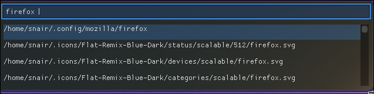

# Fizz - System Wide Fuzzy Search!
* A super quick system wide fuzzy search app.
* Specialises in finding files

## Quick Temp Demo


## V1
* I cannot speak to this thing's reliability but it seems to work on my PC™ for now (Arch btw).

## Prerequisites
* For now I have only tested this on Arch Linux.
* Install the following dependencies:
```bash
sudo pacman -S base-devel glfw-x11 imgui
```

## Run these after cloning the repo to install
```bash
git clone https://github.com/S-idN/fizz.git
cd fizz (or wherever it's cloned to)
chmod +x install.sh
./install.sh
```
* By default it will try to set Ctrl+<Super>+Space as the hotkey but if it already exists in hyprland.conf it'll skip the hotkey setting step.

## TL;DR of working
* I wanted to make a spotlight style file finder tool that was relatively quick and worked sorta like Spotlight or the Windows PowerToys search tool.
* **Inotify** detects file changes which then causes the daemon to generate a binary cache file containing structs (with file info) and a character array (of file names).
* As the user enters the query the search function is called, it ranks the characters and gives them scores.
* **Bounded Levenshtein distance** is used with further score boosts for exact filename matches and a lesser boost for a substring match.

## Up Next
* Add a content parsing step to match not only filenames but match the contents within the files
* Add an intermediary binary cache, a transient cache that contains recently updated files
* Improve the frontend, I don't have much experience using Dear imGUI so that needs to improved

